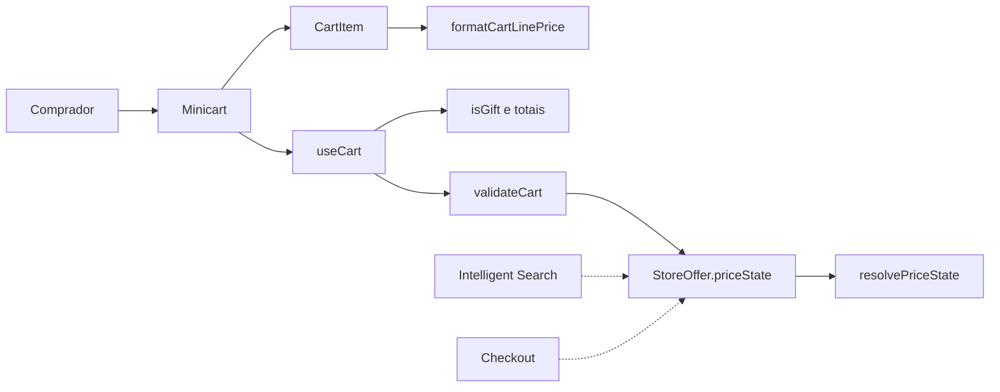
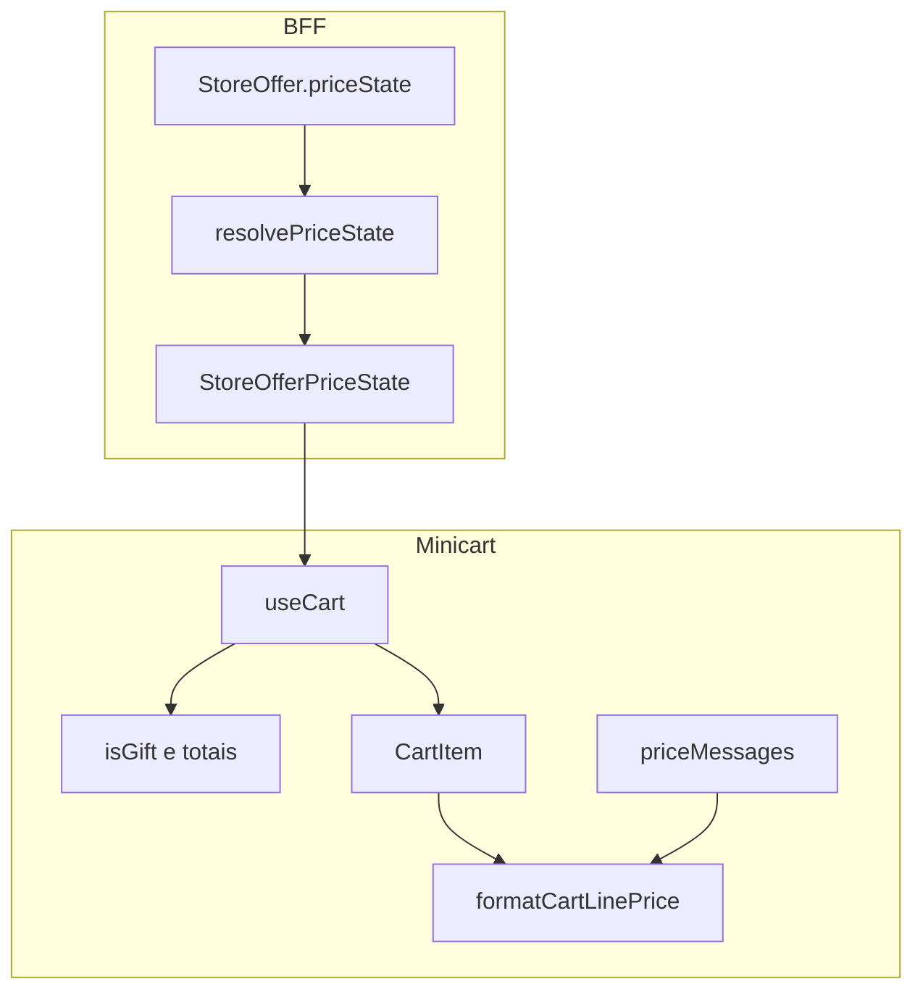
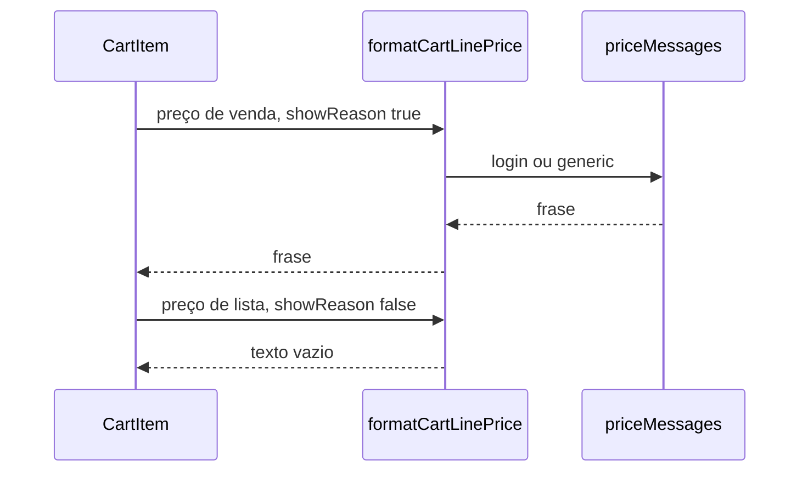
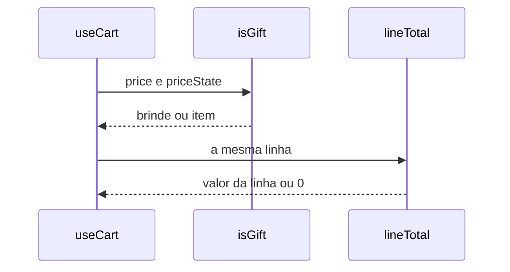
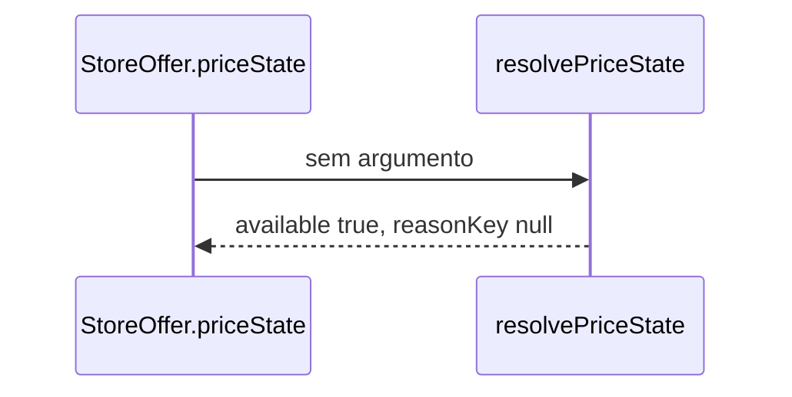
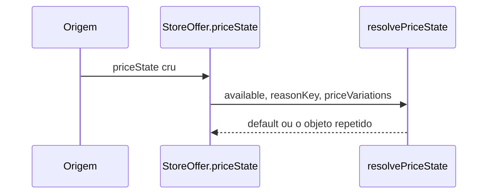
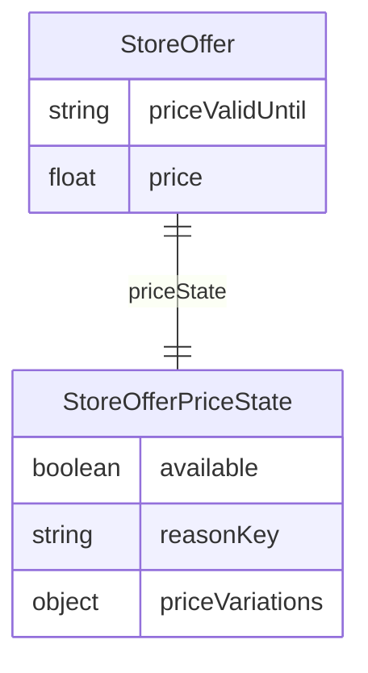

# Frase do preço no minicart

> **Last updated**: 2026-11-26

## Overview

O minicart mostra a frase no lugar do preço de venda quando `priceState.available` é `false`, e separa brinde de item pela regra de preço zero. O BFF publica `priceState` em cada `StoreOffer`. Este documento cobre esse objeto, o repasse da origem e a frase na linha. Ficam de fora o Checkout, o TTL da CDN, `priceAffectingParams`, o que a tela faz com `priceVariations` e a lista de membros do enum.

## System Context

O comprador vê o minicart. O minicart lê o carrinho validado. `validateCart` devolve ofertas, e cada oferta traz `priceState`. Intelligent Search e Checkout são a origem desse objeto. O resolver de `StoreOffer` ainda não lê essa origem.

## Building Blocks

| Component | Responsibility | Owns |
|---|---|---|
| `resolvePriceState` | Devolve `available: true` e `reasonKey: null` sem origem. Com `available === false`, repete o `reasonKey` | O objeto `{ available, reasonKey }` |
| `StoreOffer.priceState` | Chama `resolvePriceState()` sem argumento | O campo da oferta |
| `StoreOfferPriceState` | Publica `available: Boolean!` e `reasonKey: String` | O tipo GraphQL |
| `reasonKey` enum (planned, not yet implemented) | Substitui `String` quando a lista de membros existir | O conjunto fechado de razões |
| `priceVariations` (planned, not yet implemented) | Copia o objeto da origem e não lê as chaves. Sem objeto, o campo é nulo | `JSONObject` anulável |
| `formatCartLinePrice` | Com `available === false`, devolve a frase de login ou a frase genérica. No preço de lista, devolve `''` | O texto da linha |
| `isGift`, `lineTotal`, `lineTotalWithTaxes`, `subtotalAmount` | Separam brinde e zeram os totais da linha indisponível | Os números do minicart |
| `useCart` | Parte `gifts` e `items`, e soma com essas funções | O carrinho exibido |
| `priceMessages` | Guarda as duas frases no CMS | `login` e `generic` |
| `getBaseId` | Acrescenta `Gift` ao id quando `price < 0.01` | A identidade da linha |
| `applyPriceMock` | Em desenvolvimento, substitui `priceState` a partir de `localStorage` | Nada em produção |

## Key Flows

### Frase na linha indisponível

`CartItem` formata o preço com `formatCartLinePrice`. O preço de venda passa `showReason` verdadeiro. O preço de lista passa `variant === 'listing'` e recebe `''`. Com `available === false` e `reasonKey === 'PRICE_REQUIRES_LOGIN'`, o texto é `priceMessages.login`. Qualquer outro `reasonKey`, inclusive vazio, usa `priceMessages.generic`. Os defaults do CMS são `Sign in to see the price` e `Calculating`, em `packages/core/cms/faststore/sections.json`. Com `available` diferente de `false`, a função devolve o preço formatado.

### Brinde e total da linha

`useCart` chama `isPriceGift` quando `experimental.useIsGiftFromOrderForm` é falso. Preço `0` sem `available: false` vai para `gifts` e não incrementa `totalItems`. `available: false` vai para `items`. `lineTotal` e `lineTotalWithTaxes` multiplicam preço por quantidade, e os dois retornam `0` quando `available` é `false`. `subtotalAmount` troca o valor de lista por `0` na mesma condição. `getBaseId` não participa dessa divisão.

### Default sem origem

`resolvePriceState()` sem argumento, com `null`, ou com `available` diferente de `false`, retorna `{ available: true, reasonKey: null }`. `StoreOffer.priceState` usa esse caminho em toda oferta. `priceValidUntil` continua `String!` na oferta, ao lado de `priceState`.

### Repasse da origem (planned, not yet implemented)

O resolver lê `priceState` no item cru da busca e no item cru do orderForm quando o objeto está presente, e passa esse objeto a `resolvePriceState`. Os tipos desses itens neste repositório não declaram o campo. `priceVariations` segue no resultado quando o objeto veio, e fica nulo quando não veio. O BFF não lê as chaves. `scalar JSONObject` precisa de `serialize` e `parse` em `getResolvers`, porque o scalar declarado não está registrado. O fragmento `CartItem` pede `available` e `reasonKey`. Não pede `priceVariations`.

## Data Model

`StoreAggregateOffer` não tem `priceState`. Os números ficam na oferta. `priceValidUntil` fica na oferta.

`reasonKey` no tipo publicado é `String`. O enum e `priceVariations` estão em [ADR-0001](../adrs/adr-0001-contrato-do-price-state.md) e ainda não estão no schema. A regra do brinde está em [ADR-0002](../adrs/adr-0002-brinde-nao-e-preco-indisponivel.md).

## Interfaces

| Interface | Direction | Contract |
|---|---|---|
| `StoreOffer.priceState` | Exposes | `StoreOfferPriceState!`. Hoje `{ available: Boolean!, reasonKey: String }` |
| `reasonKey` enum (planned, not yet implemented) | Exposes | Enum anulável. Membros em aberto |
| `priceVariations` (planned, not yet implemented) | Exposes | `JSONObject` anulável. Cópia do objeto da origem |
| `resolvePriceState` | Exposes | Sem origem, `{ available: true, reasonKey: null }` |
| Fragmento `CartItem` | Consumes | `priceState { available reasonKey }` em `validateCart` |
| `formatCartLinePrice` | Exposes | Frase de login, frase genérica, texto vazio ou preço formatado |
| `priceMessages` | Consumes | `login` e `generic` no CMS da seção do carrinho |
| Item cru da busca e do orderForm (planned, not yet implemented) | Consumes | Objeto `priceState` quando a origem envia |

## Cross-Cutting Concerns

O fragmento do carrinho já pede `priceState`. Mudar o tipo de `reasonKey` altera o hash dessa persisted query uma vez. As queries de produto e de busca em `packages/core/src` não pedem `priceState`, então a vitrine não mostra a frase por este caminho.

`useCart` aplica `applyPriceMock` antes da divisão e dos totais. Fora de produção, `localStorage.fsPriceMock` pode ser `missing`, `unavailable`, `gift` ou `priced`. Em produção, `readPriceMock` retorna `null` e o carrinho segue o que a API devolveu. `PriceMockSwitch` não renderiza em produção.

## References

| Doc | Why it matters here |
|---|---|
| [preco-externo-storefront](../brainstorms/preco-externo-storefront/session.md) | `Threads > Contrato do priceState` fecha o enum, o objeto livre e a frase |
| [ADR-0001](../adrs/adr-0001-contrato-do-price-state.md) | Forma de `priceState` e o default sem origem |
| [ADR-0002](../adrs/adr-0002-brinde-nao-e-preco-indisponivel.md) | Brinde, totais da linha e o id `Gift` |
| [Sem origem, o BFF devolve o preço como disponível](../brainstorms/preco-externo-storefront/knowledge/bff-devolve-price-state-disponivel.md) | Evidência de `resolvePriceState` e do tipo publicado |

## Open Questions

A lista de membros de `reasonKey` não está fechada. Enquanto não estiver, o campo publicado continua `String`, e a frase segue a regra de `PRICE_REQUIRES_LOGIN` contra qualquer outro valor.
