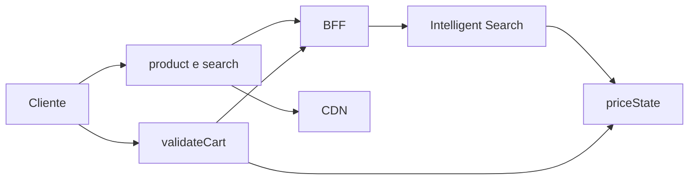
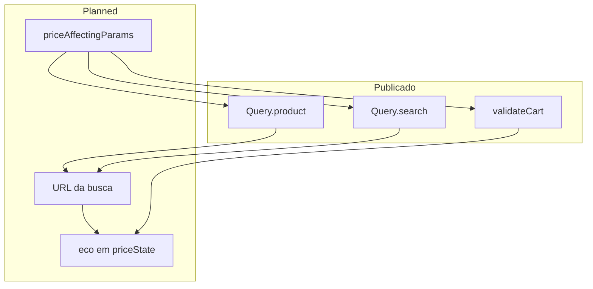
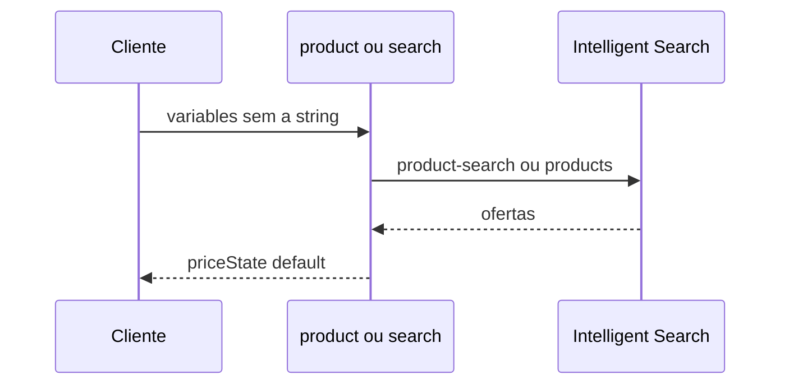
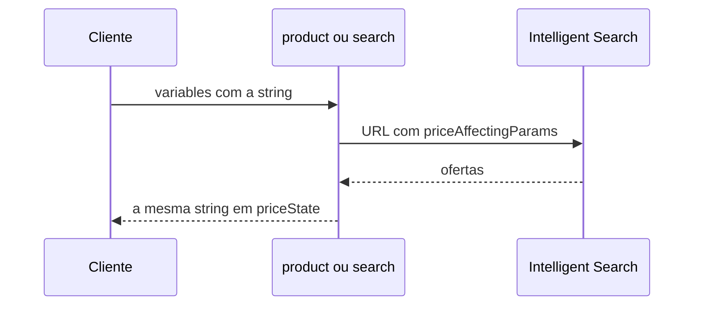
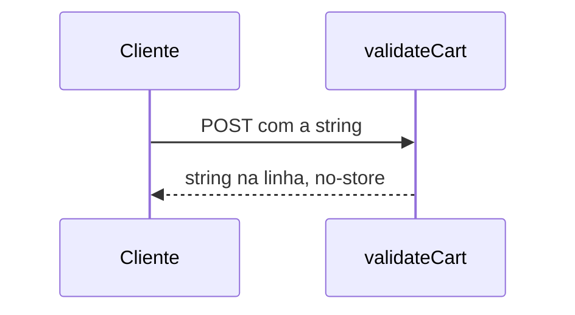
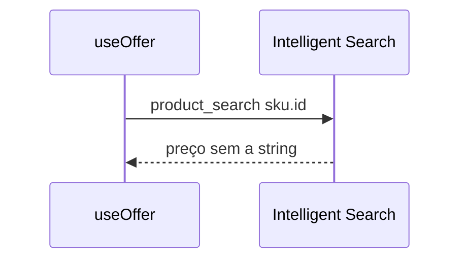
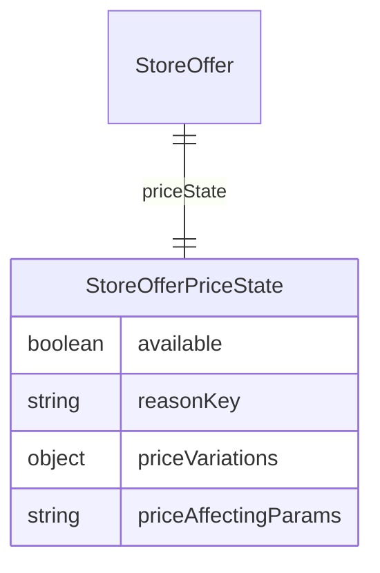

# Query generalista e validateCart

> **Last updated**: 2026-11-26

## Overview

O cliente manda uma string opcional quando o preço depende de um dado que a query nativa não tem. O BFF copia essa string para a Intelligent Search e a devolve em `priceState`. O carrinho aceita a mesma string e a devolve na linha. A gravação no orderForm espera um campo já nomeado. Ficam de fora os argumentos nativos `quantity` e `paymentMethod`, `useOffer`, o HTML estático, o TTL da fase 2 e o desenho da tela além da frase. A fase espera a fase 1 em `Merged`.

## System Context

A vitrine pede `product` ou `search` por GET. O carrinho pede `validateCart` por POST. Os dois podem carregar `priceAffectingParams`. A busca copia o texto para a URL da Intelligent Search. O carrinho devolve a string na linha. A CDN parte no GET. A mutation não entra no cache.

## Building Blocks

| Component | Responsibility | Owns |
|---|---|---|
| `Query.product` e `Query.search` | Recebem `locator` ou paginação, termo e facets. Não recebem `priceAffectingParams` | Os argumentos publicados |
| `validateCart` | Recebe `cart` e `session`. Atualiza o orderForm. Não declara `@cacheControl` | A mutation |
| `buildIntelligentSearchRequest` | Monta `product-search`, `facets` e `products` | A URL da busca |
| `GETRequest` | Coloca `operationName`, `operationHash` e `variables` na query string | A chave da CDN no GET |
| `setOrderFormEtag` | Grava `cartEtag` no custom app `faststore` | O etag do carrinho |
| `useOffer` | Busca `/api/intelligent-search/product_search?query=sku.id:` | O preço no browser |
| Argumento `priceAffectingParams` (planned, not yet implemented) | String opcional em `product`, `search` e `validateCart`. Ausente, `null` e `""` não seguem | O texto do cliente |
| Query param na busca (planned, not yet implemented) | Copia o texto para a URL de `product-search` e de `products` | A chave do Janus |
| `priceState.priceAffectingParams` (planned, not yet implemented) | Repete a string em cada oferta da resposta. Sem string, fica nulo | O eco |
| Eco na linha (planned, not yet implemented) | A mutation devolve em `priceState` a string recebida | A linha do carrinho |

## Key Flows

### Consulta sem a string

`Query.product` recebe `locator`. `Query.search` recebe `first`, `after`, `sort`, `term`, `selectedFacets` e `sponsoredCount`. O cliente de busca monta a URL em `buildIntelligentSearchRequest` sem parâmetro de preço. O GET leva `variables` como JSON. Sem a string nesse JSON, a URL da CDN é a de hoje. `resolvePriceState()` sem origem devolve `available: true` e `reasonKey: null`.

### Consulta com a string (planned, not yet implemented)

A operação do cliente declara `$priceAffectingParams: String` e envia o valor só quando ele existe. O resolver copia o texto para o query param `priceAffectingParams` de `product-search` e de `products`. Não lê o JSON e não ordena as chaves. Cada oferta da resposta traz a mesma string em `priceState.priceAffectingParams`. Sem string, o campo GraphQL é nulo. A CDN parte porque `variables` mudou. O Janus parte porque a URL da busca mudou. `{}` e outra ordem de chaves são outras entradas.

As queries nativas de produto e de busca não declaram a variável. Uma variável fora da operação muda a URL do GET e o resolver não a recebe.

### Carrinho (planned, not yet implemented)

`validateCart` recebe a mesma string. O método continua POST: o nome `ValidateCartMutation` não está na lista de operações cacheadas, e o handler sem hint responde `no-cache, no-store`. Cada linha devolve em `priceState` a string recebida na mutation. A gravação no orderForm espera um campo já nomeado. `setOrderFormEtag` continua gravando só `cartEtag` no app `faststore`. O loop não cria `customData`.

### Fora do argumento

`useOffer` monta `product_search` com `sku.id` e não passa pelo BFF. A primeira pintura estática sai de `getStaticProps` sem essa string. Quantidade e meio de pagamento ficam dentro do JSON de quem envia a string. We Buy / We Sell continua facet `category-1`. Moeda continua no sales channel.

## Data Model

`priceState` ganha um campo. Os demais seguem [ADR-0001](../adrs/adr-0001-contrato-do-price-state.md).

`priceAffectingParams` no tipo ainda não existe. `reasonKey` publicado continua `String` até a lista do enum fechar.

## Interfaces

| Interface | Direction | Contract |
|---|---|---|
| `Query.product` e `Query.search` | Exposes | Argumentos atuais, sem a string |
| `priceAffectingParams` (planned, not yet implemented) | Exposes | `String` opcional em `product`, `search` e `validateCart` |
| URL `product-search` e `products` (planned, not yet implemented) | Consumes | Query param com o texto copiado |
| `priceState.priceAffectingParams` (planned, not yet implemented) | Exposes | A string enviada, ou nulo |
| `validateCart` | Exposes | POST, sem `@cacheControl`, resposta `no-store` |
| Atualização do orderForm | Consumes | Fora deste loop. Espera um campo já nomeado. Sem `customData` novo |
| `useOffer` | Consumes | `product_search` com `sku.id` |

## Cross-Cutting Concerns

Pedir o campo novo no fragmento do carrinho muda o hash dessa persisted query uma vez. Conta que não manda a string mantém a URL de variáveis de hoje nas queries que não declaram o argumento. Pedido com cookie de autenticação segue `private` no GET. Esta fase não altera o cap de TTL.

## References

| Doc | Why it matters here |
|---|---|
| [preco-externo-storefront](../brainstorms/preco-externo-storefront/session.md) | `Threads > Plano generalista` e `Threads > Volta do parâmetro` |
| [ADR-0004](../adrs/adr-0004-string-price-affecting-params.md) | A string, o eco, o carrinho e o que fica de fora |
| [ADR-0001](../adrs/adr-0001-contrato-do-price-state.md) | Os campos de `priceState` que este campo acompanha |
| [As queries nativas não recebem quantity nem paymentMethod](../brainstorms/preco-externo-storefront/knowledge/queries-nativas-sem-quantity-payment.md) | `product` e `search` hoje não têm esses argumentos |

## Open Questions

O campo do orderForm que recebe a string não está escolhido. O app `faststore` hoje só tem `cartEtag`. Esta fase não cria campo novo de `customData`.
