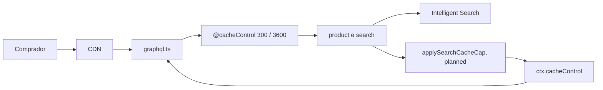
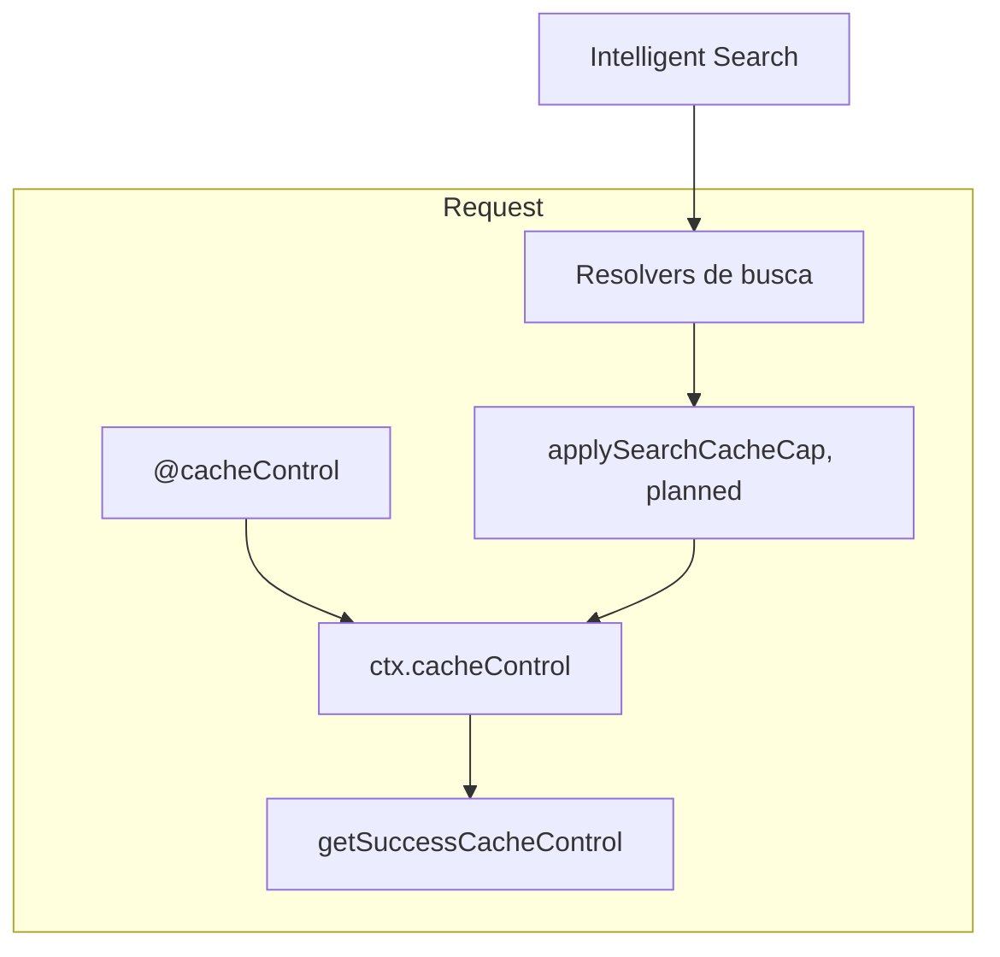
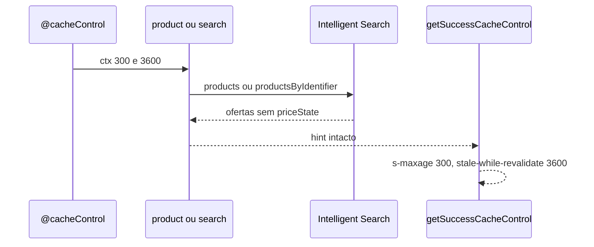
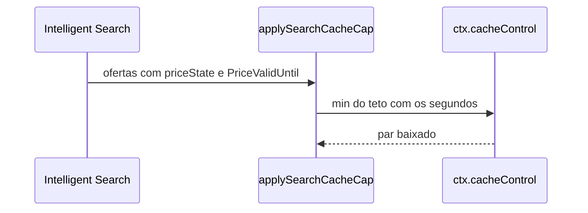
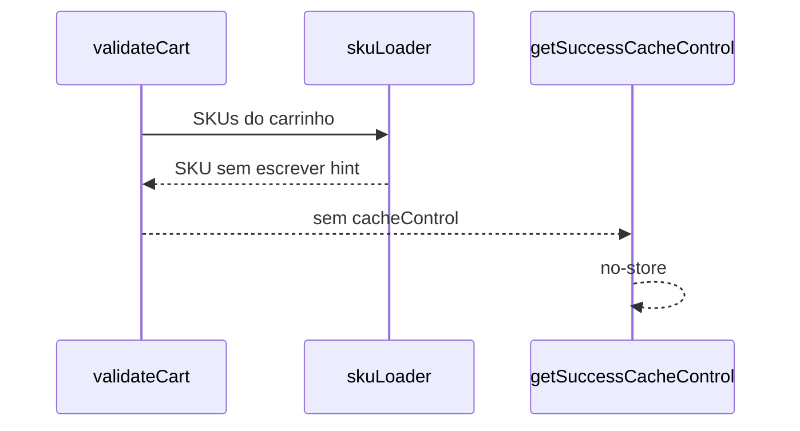
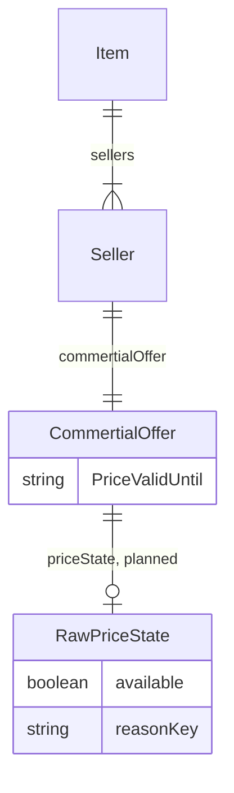

# TTL da CDN quando o priceState vem

> **Last updated**: 2026-11-26

## Overview

A CDN guarda a resposta de produto e de busca por 5 minutos e aceita resposta velha por 1 hora. Este documento cobre o encurtamento desse par até `PriceValidUntil`, e só quando a Intelligent Search mandou `priceState` na oferta. Ficam de fora `discovery.config`, o TTL do Janus, `priceAffectingParams` e `validateCart`. A fase espera a fase 1 em `Merged`.

## System Context

O handler GraphQL copia `ctx.cacheControl` para o header `cache-control` depois da operação. A diretiva escreve 300 e 3600 antes do resolver de `product` e de `search`. O cap lê o payload da Intelligent Search e, quando o objeto cru está presente, baixa esses dois números. O cliente de busca não envia TTL ao Janus.

## Building Blocks

| Component | Responsibility | Owns |
|---|---|---|
| `@cacheControl` | Grava em `ctx.cacheControl` o menor `sMaxAge`, o menor `staleWhileRevalidate` e o scope mais restrito, antes do resolver | O hint da operação |
| `getSuccessCacheControl` | Usa o hint coletado. Sem hint, GET de query cai no default de 300 e 3600; o resto responde `no-store` | O header `cache-control` |
| `stringify` | Com cookie de autenticação, força `scope` `private` | O texto do header |
| `Query.product` | Carrega o SKU por `skuLoader` e devolve esse SKU | A resposta de produto |
| `Query.search` | Dispara `clients.search.products` e devolve a promise | A promise do payload |
| `StoreSearchResult.products` e `suggestions` | Aguardam o payload e montam os SKUs | Os produtos da busca |
| `Query.allProducts` e `Query.products` | Lêem o mesmo cliente de busca, com o mesmo `@cacheControl` público | As outras respostas de produto |
| `applySearchCacheCap` (planned, not yet implemented) | Lê `priceState` cru nas ofertas comerciais e baixa o par do hint | Nada persistido |
| `resolvePriceState` | Sem origem, devolve `available: true` e `reasonKey: null`. Não lê data e não escreve hint | O objeto GraphQL |
| `skuLoader` | Busca SKUs na Intelligent Search para produto e para o carrinho. Não escreve hint | O SKU |

## Key Flows

### Resposta sem priceState cru

`Query.product` e `Query.search` carregam a diretiva pública de 300 e 3600. `CommertialOffer.PriceValidUntil` já vem no tipo da busca. Nenhuma oferta comercial traz objeto `priceState`. `resolvePriceState()` preenche `available: true` na oferta GraphQL. O hint permanece 300 e 3600. `experimental.graphqlCacheControl` não entra: ele só vale quando a operação não coletou hint.

### Cap pela data (planned, not yet implemented)

`applySearchCacheCap` percorre `sellers[].commertialOffer` do payload. Objeto `priceState` presente liga o cap. `null` e campo ausente não ligam. Entre as ofertas com objeto, a função lê `PriceValidUntil`. Valor que não parseia como data fica de fora. Sem nenhuma data válida, o hint segue 300 e 3600. A data mais cedo define o restante, em segundos inteiros arredondados para baixo. `sMaxAge` vira `min(300, restante)` e `staleWhileRevalidate` vira `min(3600, restante)`. A função só baixa o par já gravado no contexto. Data no passado, ou restante menor que 1 segundo, grava 0 nos dois. O scope não muda.

A função roda em `Query.product`, em `StoreSearchResult.products`, em `StoreSearchResult.suggestions` quando ele lê produtos, em `Query.allProducts` e em `Query.products`. Esses campos declaram o mesmo hint público e devolvem oferta da busca.

### validateCart fora do cap

`validateCart` não declara `@cacheControl`. O handler, sem hint e fora de um GET cujo nome termina em `query`, responde `no-cache, no-store`. O carrinho usa `skuLoader`. O loader não chama `applySearchCacheCap`. A data do orderForm não entra na conta.

## Data Model

O cap não cria tipo novo. Ele lê a oferta comercial da busca. `priceState` nesse objeto ainda não está no tipo `CommertialOffer`. `PriceValidUntil` já está, como `string`.

## Interfaces

| Interface | Direction | Contract |
|---|---|---|
| `Query.product` e `Query.search` | Exposes | `@cacheControl(scope: "public", sMaxAge: 300, staleWhileRevalidate: 3600)` |
| `Query.allProducts` e `Query.products` | Exposes | O mesmo par público |
| `ctx.cacheControl` | Exposes | `{ sMaxAge, staleWhileRevalidate, scope }` lido por `execute` em `packages/core/src/server/index.ts` |
| `applySearchCacheCap` (planned, not yet implemented) | Exposes | Baixa o par só com `priceState` cru e `PriceValidUntil` parseável |
| `CommertialOffer.PriceValidUntil` | Consumes | `string` já presente no payload |
| `CommertialOffer.priceState` (planned, not yet implemented) | Consumes | Objeto cru. Ausente ou `null` deixa o teto |
| Cliente de busca | Consumes | Não envia `Cache-Control` |

## Cross-Cutting Concerns

Pedido com cookie `VtexIdclientAutCookie` sai `private`. O cap não troca o scope. O fallback `experimental.graphqlCacheControl` em `discovery.config` só preenche operação sem hint. `product` e `search` sempre têm hint da diretiva.

O cliente de Intelligent Search neste repositório não escreve `s-maxage` na ida ao Janus. O teto de 10 minutos de lá fica fora.

## References

| Doc | Why it matters here |
|---|---|
| [preco-externo-storefront](../brainstorms/preco-externo-storefront/session.md) | `Threads > Cache da fase 2` fecha o sinal cru e a conta do `min` |
| [ADR-0003](../adrs/adr-0003-ttl-cdn-so-com-price-state-da-origem.md) | O cap, o que não liga e o Janus fora do repositório |
| [ADR-0001](../adrs/adr-0001-contrato-do-price-state.md) | O default `available: true` não é o objeto da origem |
| [O TTL de product e search é fixo no schema](../brainstorms/preco-externo-storefront/knowledge/cache-graphql-e-estatico.md) | Diretiva, handler e ausência de TTL no cliente de busca |
